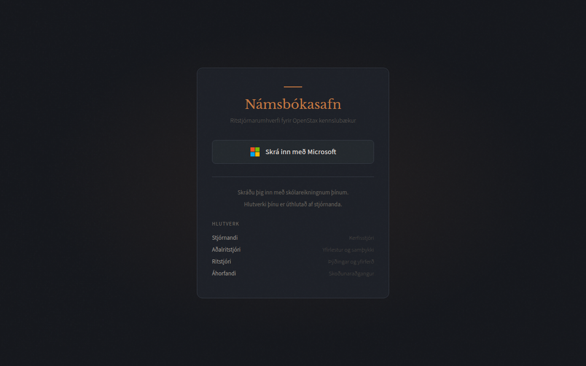
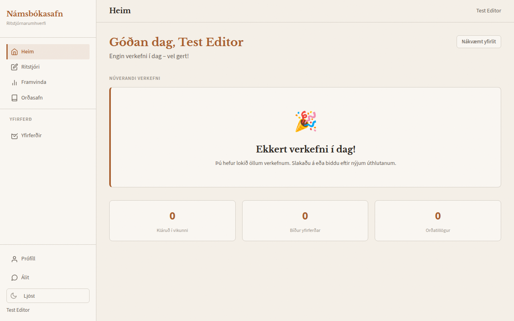
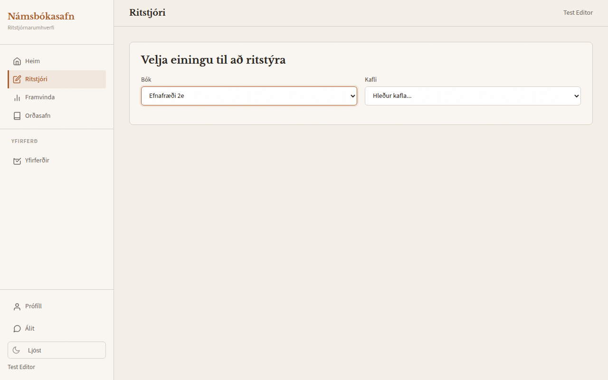
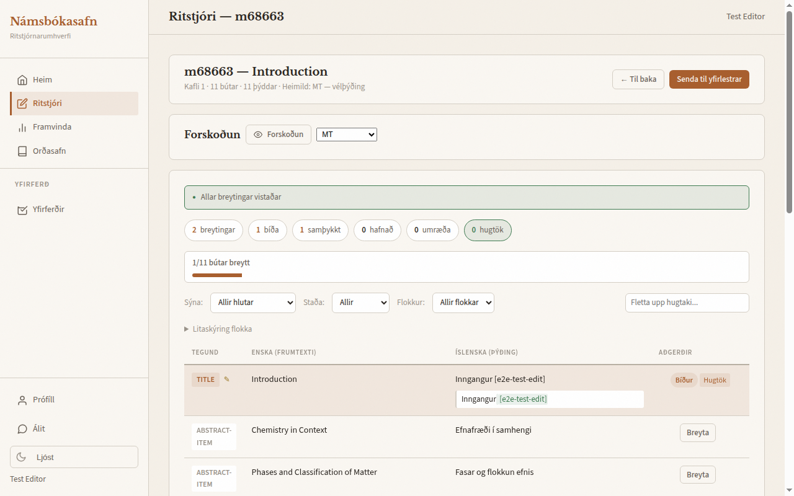
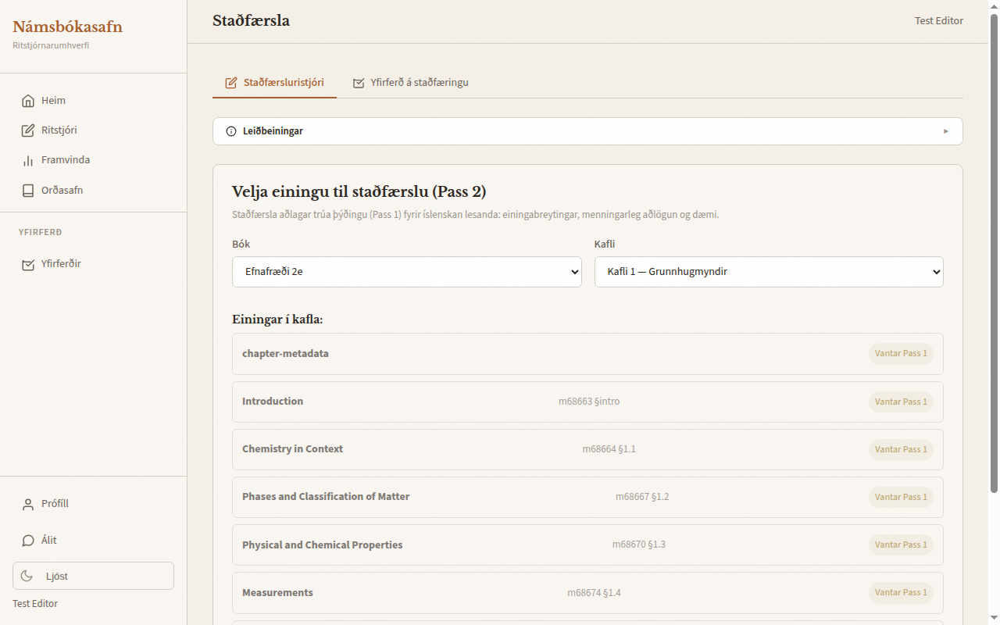
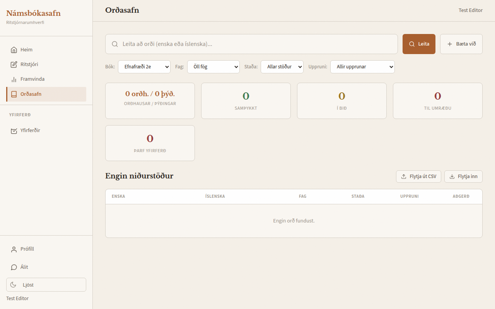
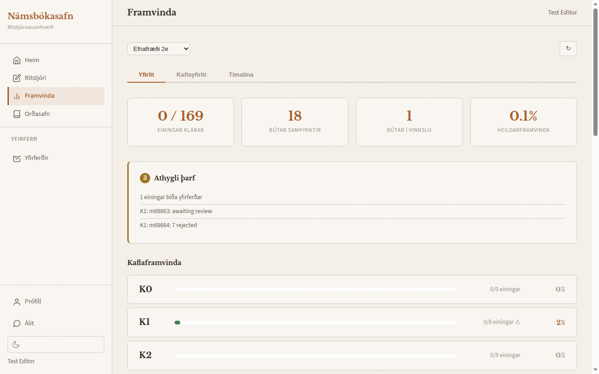
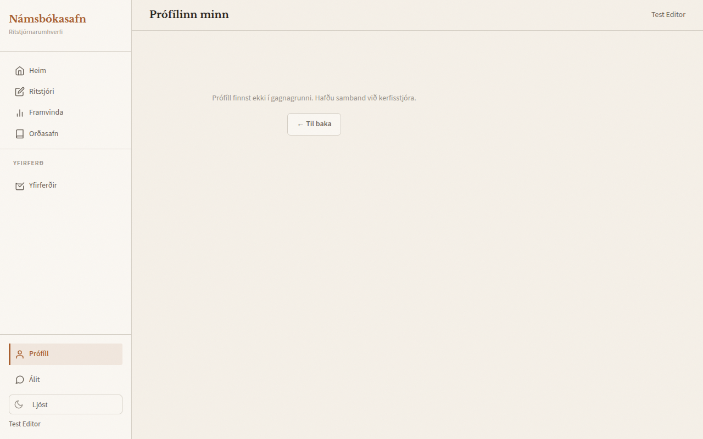
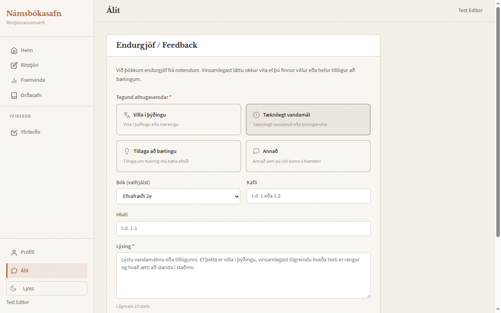

# Leiðbeiningar fyrir ritstjóra — Námsbókasafn

Velkomin í þýðingateymi Námsbókasafnsins! Þessar leiðbeiningar fara með þér yfir allt sem þú þarft að vita til að byrja að yfirfara og ritstýra þýðingum á OpenStax-kennslubókum yfir á íslensku.

> **Sjá einnig:** [Yfirlestur 1: Málfarsyfirlestur](../editorial/pass1-linguistic.md) og [Yfirlestur 2: Staðfærsla](../editorial/pass2-localization.md) fyrir nákvæmar leiðbeiningar um ritstýringu.

> **Um skjámyndirnar:** þær voru teknar í mars 2026 og nokkur heiti hafa breyst síðan
> (ritillinn heitir t.d. nú **Ritill**). Þar sem skjámynd og texti stangast á lýsir textinn
> kerfinu eins og það er núna.

---

## 1. Til að byrja

### Hvað er Námsbókasafn?

Námsbókasafn er ritstjórnarvettvangur til að þýða opnar OpenStax-kennslubækur yfir á íslensku. Vinnuferlið hefur tvær yfirferðir:

| Yfirferð | Heiti | Tilgangur |
|---|---|---|
| **Yfirferð 1** | Málfarsleg yfirferð | Laga málfar, nákvæmni og hugtök í vélþýðingunni |
| **Yfirferð 2** | Staðfærsla | Aðlaga að íslenskum nemendum: breyta mælieiningum, skipta út menningartilvísunum, bæta við staðbundnu samhengi |

Þýðingarferlið er svona:

```
Vélþýðing → Yfirferð 1 (Nákvæm þýðing) → Yfirferð 2 (Staðfærð útgáfa)
```

### Þitt hlutverk sem ritstjóri

Sem ritstjóri getur þú:
- Lesið yfir og ritstýrt þýddum textaköflum (Yfirferð 1)
- Flett upp og lagt til hugtök
- Fylgst með framvindu þinni í köflunum

Staðfærsla (Yfirferð 2) er opnuð af hliðarstikunni og sést aðeins yfirritstjórum og kerfisstjórum.

### Að skrá sig inn

1. Farðu á ritstjórnarvefinn (umsjónarmaðurinn þinn gefur þér vefslóðina)
2. Þú munt sjá innskráningarsíðuna:



3. Smelltu á **„Skrá inn með Microsoft“**
4. Skráðu þig inn með Microsoft-skólaaðgangnum þínum
5. Eftir að innskráning hefur tekist ferðu á heimasíðuna (**Heim**) — eða aftur á síðuna sem þú komst frá, ef þér var vísað þaðan á innskráningarsíðuna

> **Athugið:** Kerfisstjóri úthlutar þér hlutverki. Ef síðan **Um mig** segir **Þú ert gestur**
> er enginn aðgangur til fyrir þig í kerfinu enn: þú getur skoðað þig um en ekki breytt neinu.
> Hafðu þá samband við kerfisstjóra.

---

## 2. Viðmótið

### Mælaborð

Eftir innskráningu ferðu á heimasíðuna (**Heim**). Þar birtist kveðja með nafninu þínu og fjöldi verkefna þinna.



Mælaborðið sýnir:
- **Núverandi verkefni**, með hnappi til að hefja vinnu, og **Næst á dagskrá**
- **Tölfræði**: ritstjórar sjá hvað þeir kláruðu í vikunni (*Kláruð í vikunni*), hvað bíður yfirlestrar (*Bíður yfirlestrar*) og orðatillögur sínar (*Orðatillögur*); yfirritstjórar og kerfisstjórar sjá hvað bíður úrskurðar þeirra og hvað er samþykkt en óbirt
- **Nákvæmt yfirlit**: innsendingar þínar sem bíða yfirlestrar, breytingar sem voru sendar aftur til þín með athugasemd yfirlesara (*Breytingar óskast*), orðatillögur þínar og nýleg virkni þín

### Leiðsagnarstika

Stikan vinstra megin er aðalleiðsögnin þín. Hlutar sem sjást fara eftir hlutverki þínu:

**Allir innskráðir sjá:**
- **Heim** — Mælaborðið þitt
- **Ritill** — Textaritillinn fyrir Pass 1
- **Framvinda** — Yfirlit yfir framvindu þýðinga
- **Orðasafn** — Hugtakagagnagrunnurinn

**Ritstjórar, yfirritstjórar og kerfisstjórar sjá einnig hlutann Yfirlestur:**
- **Yfirlestrar** — Ritillinn, síaður á breytingar sem bíða yfirlestrar
- **Aðlögun** — Staðfærsluritillinn fyrir Pass 2 (aðeins yfirritstjórar og kerfisstjórar)

**Yfirritstjórar og kerfisstjórar sjá einnig hlutann Stjórnun:**
- **Bókasafn** og **Úthlutanir**; kerfisstjórar sjá einnig **Stjórnandi**

**Neðst:**
- **Um mig** — Prófíllinn þinn
- **Ábendingar** — Sendu inn ábendingar um þýðingar
- **Þemaskiptir** — Skiptu á milli ljósrar og dökkrar stillingar

---

## 3. Pass 1: Ritill (málfarsleg yfirferð)

Þú munt eyða mestum tíma þínum í **Ritli**. Hann sýnir staka textabúta (málsgreinar, fyrirsagnir, atriði í listum) svo þú getir farið yfir vélþýðinguna og leiðrétt villur.

> **Markmið:** Að búa til *trúa þýðingu* — eðlilega, nákvæma íslensku sem endurspeglar frumtextann náið. EKKI staðfæra (það er gert í Pass 2).

### Velja einingu

1. Farðu í **Ritil** á hliðarstikunni
2. Veldu **bók** (*Bók*, t.d. „Efnafræði 2e“ fyrir Chemistry)
3. Veldu **kafla** (*Kafli*)
4. Þú sérð einingarnar í kaflanum (*Einingar í kafla*) — smelltu á eina til að hefja vinnu



Hver eining sýnir stöðumerki, til dæmis:
- **EN** — Enskir frumtextabútar eru til staðar
- **MT** — Vélþýðing er tiltæk
- **Ritstýrt** / **Staðfært** — Einingunni hefur verið ritstýrt / hún hefur verið staðfærð
- **⚠ N** — Sjálfvirk vélþýðingarskoðun merkti N textabúta

### Ritun hluta

Eftir að smellt er á einingu hleður ritillinn öllum textabútum hennar inn í töflu:



- **Enska (frumtexti):** Enskur frumtexti (ekki hægt að breyta)
- **Íslenska (þýðing):** Íslensk þýðing
- **Aðgerðir:** Aðgerðir fyrir textabútinn

Fyrir ofan töfluna eru síur: hvað á að sýna (*Sýna*), staða (*Staða*: óbreyttir, óyfirfarnir, breyttir, samþykktir, staðfestir, hafnaðir, í umræðu) og flokkur (*Flokkur*).

**Til að breyta textabút:**

1. Smelltu á **Breyta** í línu textabútsins
2. Gerðu leiðréttingu þína
3. Veldu **flokk** fyrir breytinguna þína (*Flokkur*):
   - **Hugtök** — Skipt um hugtak eða stöðlun
   - **Nákvæmni** — Staðreyndaleiðrétting eða lagfæring á rangþýðingu
   - **Læsileiki** — Málfar, stafsetning eða skýrleikabætur
   - **Stíll** — Tónn eða stíllagaðlögun
   - **Úrfelling** — Bætt við efni sem vantaði
4. Þú getur einnig bætt við **athugasemd** (*Athugasemd (valkvætt)*) til að útskýra breytinguna þína
5. Smelltu á **Vista** eða ýttu á Ctrl+S

> **Vistun:** breytingin berst kerfinu aðeins þegar þú vistar hana. Þangað til geymir vafrinn
> drög á nokkurra sekúndna fresti, svo hægt er að endurheimta þau ef flipanum er lokað, en
> enginn annar sér þau.

**Ef vélþýðingin er þegar rétt** skaltu smella á **✓ Staðfesta MT** í stað þess að breyta. Þá telst textabúturinn yfirfarinn; hægt er að afturkalla það.

**Fleiri hjálpartæki í ritlinum:**
- **Hugtakaleit** (*Fletta upp hugtaki…*) — flettu upp hugtaki án þess að fara af síðunni; hugtök í textanum eru auðkennd og opna glugga með þýðingum sínum
- **Samhengisleit** — leitaðu í áður samþykktum þýðingum
- **Þegar samþykkt í …** — sami texti hefur þegar verið samþykktur annars staðar; **Nota þessa þýðingu** endurnýtir hann
- **Beita víðar** — beittu þýðingunni þinni á eins textabúta annars staðar í bókinni
- **Forskoðun** — sjáðu hvernig einingin mun líta út fyrir lesendur

### Hvað á að laga (og hvað ekki)

| Gera | Ekki gera |
|----|--------|
| Laga málfar og stafsetningu | Breyta einingum (mílur, Fahrenheit o.s.frv.) |
| Bæta orðaval til að auka skýrleika | Breyta menningartengdum tilvísunum |
| Tryggja eðlilega íslensku | Bæta við íslenskum dæmum |
| Athuga samræmi í hugtakanotkun | Fjarlægja eða bæta við efni |
| Staðfesta tæknilega nákvæmni | Staðfæra nokkuð |

### Senda til yfirlestrar

Þegar þú hefur farið yfir alla textabúta í einingu:

1. Smelltu á **„Senda til yfirlestrar“**
2. Breytingarnar þínar fara til yfirritstjóra til samþykktar
3. Þú getur fylgst með innsendingum þínum á heimasíðunni: **Nákvæmt yfirlit → Bíður yfirlestrar**

Yfirritstjórinn merkir síðan hverja breytingu:
- **Samþykkja**
- **Hafna**, með ástæðu
- **Ræða**, með umræðuefni

Athugasemd yfirritstjóra berst þér á heimasíðunni undir **Breytingar óskast**, með hnappinum
**Laga**. Þegar breyting er merkt **Ræða** sýnir lína hennar í ritlinum hnappinn
**💬 Umræða**: hann opnar umræðuefni yfirritstjórans og svörin hingað til, og þar getur þú svarað
með **Senda svar**. Svar breytir ekki stöðu breytingarinnar; yfirritstjórinn ákveður áfram.
Breytingu sem á umræðu er ekki hægt að eyða; breyttu henni frekar.

---

## 4. Áfangi 2: Staðfærsluritill

Eftir að áfangi 1 skilar af sér nákvæmri þýðingu er hún aðlöguð fyrir íslenska nemendur í áfanga 2. Þetta er sérstakur ritill sem er hannaður fyrir menningarlega aðlögun. Hann er opnaður úr **Aðlögun** á hliðarstikunni (yfirritstjórar og kerfisstjórar). Einingu er aðeins hægt að staðfæra þegar samþykkt nákvæm þýðing hennar er til.

### Opna staðfærsluritilinn

1. Farðu í **Aðlögun** á hliðarstikunni
2. Veldu bók og kafla
3. Smelltu á einingu til að byrja



Staðfærsluritillinn hefur tvo flipa efst:
- **Staðfærsluritill** — Ritilsviðmótið, með samanbrjótanlegu spjaldi, **Leiðbeiningar**
- **Yfirlestur á staðfæringu** — Mynsturtengdar staðfærslutillögur fyrir hluta (*Skanna*), sem má samþykkja eða hafna, og staðfærsluskráin

Þegar bók krefst yfirlestrar á staðfærslu sjá yfirritstjórar einnig spjald með staðfærslubreytingum í bið (*Staðfærsla í bið*) til að samþykkja eða hafna.

### Þriggja dálka útlit

Þegar eining er hlaðin sýnir ritillinn þrjá dálka:
- **Enska (viðmið):** Enskur frumtexti (tilvísun)
- **Trú þýðing (Pass 1):** Nákvæm íslensk þýðing úr áfanga 1 (skrifvarin, með hnappinum **Afrita**)
- **Staðfært (Pass 2):** Staðfærð útgáfa (breytanleg)

### Tegundir staðfæringar

Staðfærslubreytingar flokkast í þessar tegundir, sem sía og merki ritilsins nota:

| Tegund | Dæmi |
|---|---|
| **Einingabreytingar** | Fahrenheit → Selsíus, mílur → km |
| **Menningarleg aðlögun** | Bandarískir frídagar → íslensk samsvörun |
| **Dæmaskipti** | Dæmi sem eiga sérstaklega við í Bandaríkjunum → staðbundið samhengi |
| **Snið** | Stílbreytingar fyrir íslenskar venjur |

### Vista vinnu

- Vistaðu textabút með **✓** hnappinum hans (skýring: *Vista bút*)
- Notaðu **„Vista allt“** til að vista allar breytingar í einu
- Ritillinn vistar einnig sjálfkrafa á mínútu fresti
- **Breytingasaga** sýnir fyrri útgáfur textabúts og getur endurheimt eina þeirra

---

## 5. Orðasafn

### Hugtakagagnagrunnurinn

Farðu í **Orðasafn** á hliðarstikunni til að skoða, leita og umsýsla þýðingarhugtök.



Orðasafnssíðan býður upp á:
- **Leitarstiku** — Leitaðu eftir ensku eða íslensku hugtaki
- **Síur** — Síaðu eftir bók, fagi (*Fag*), stöðu (*Staða*) og uppruna (*Uppruni*)
- **Tölfræði** — Orðhausar og þýðingar, samþykkt, í bið, til umræðu og þarf yfirlestur
- **Hugtakatafla** — Sýnir enskt hugtak, íslenska þýðingu, fag, stöðu og uppruna
- **Yfirferðarröð** — Hugtök sem bíða yfirferðar

### Leit að hugtökum

1. Sláðu inn enska eða íslenska hugtakið í leitarstikuna
2. Síaðu að vild eftir bók, fagi, stöðu eða uppruna
3. Smelltu á **„Leita“**

### Að leggja til ný hugtök

Ef þú rekst á hugtak sem er ekki í orðasafninu:

1. Smelltu á **„Bæta við“**
2. Sláðu inn enska hugtakið og þína tillögu að íslenskri þýðingu
3. Bættu við athugasemdum til að útskýra val þitt
4. Vistaðu — hugtakið er geymt sem tillaga þar til yfirritstjóri eða kerfisstjóri samþykkir það

Þú getur líka skrifað athugasemd við hugtak sem er þegar til, og stungið upp á annarri þýðingu, í nánari sýn hugtaksins.

### Orðasafn í textaritlinum

Þegar textabútar eru rýndir í Pass 1 geturðu notað hugtakaleitina (*Fletta upp hugtaki…*) til að leita í orðasafninu án þess að fara af síðunni. Ef smellt er á auðkennt hugtak í textanum opnast gluggi með þýðingum þess, stöðu þeirra og fögum, ásamt tengli sem opnar hugtakið í **Orðasafni**.

---

## 6. Fylgjast með framvindu

Síðan **Framvinda** gefur þér yfirlit yfir framvindu þýðinga í öllum köflum.



Síðan sýnir:
- **Yfirlitstölfræði** — Einingar kláraðar, textabútar samþykktir, textabútar í vinnslu og heildarframvinda
- **Þarfnast skoðunar** — Einingar sem bíða yfirlestrar, breytingar í umræðu og kaflar með höfnuðum breytingum eða breytingum í bið
- **Kaflalisti** — Hver kafli með framvindustiku sem sýnir hversu langt ritstýringin er komin

Smelltu á kafla til að opna kaflayfirlitið (*Kaflayfirlit*) með stöðu hverrar einingar. Þriðji flipinn, **Tímalína**, sýnir tímalínu.

---

## 7. Aðrar síður

### Um mig

Farðu á **Um mig** til að sjá og uppfæra reikningsupplýsingarnar þínar: nafn, netfang (skrifvarið), skóla, kennslugrein, stutta lýsingu, hlutverk og hvenær þú skráðir þig síðast inn.



### Ábendingar

Síðan **Ábendingar** er opið eyðublað — engin innskráning nauðsynleg — til að tilkynna um vandamál í birtu efni eða leggja til úrbætur.



Þú getur sent inn ábendingar um:
- Villu í þýðingu eða merkingu
- Tæknilegt vandamál eða birtingarvillu
- Tillögu um hvernig má bæta efnið
- Annað

---

## 8. Góð ráð og úrræðaleit

### „Ég veit ekki hvernig ég á að þýða þetta hugtak“

1. Flettu upp í hugtakagrunninum í **Orðasafni**
2. Ef það finnst ekki, leggðu til nýtt hugtak
3. Bættu við athugasemd við textabútinn þar sem þú útskýrir óvissuna

### „Vélþýðingin er mjög röng“

Það er viðbúið! Þitt hlutverk er að laga hana. Ekki hika við að endurskrifa heilar setningar ef þörf krefur. Veldu flokkinn **Nákvæmni** eða **Læsileiki**.

### „Vélþýðingin er þegar rétt“

Smelltu á **✓ Staðfesta MT** svo textabúturinn teljist yfirfarinn.

### „Ég fann villu í uppbyggingu eða sniði“

- Ef hún er í þýðingartextanum, lagaðu hana og veldu flokkinn **Læsileiki**
- Ef það er birtingarvandamál (brotið útlit, myndir vantar), tilkynntu það til kerfisstjóra

### „Ég er ósammála fyrri ákvörðun um hugtak“

- Fylgdu gildandi ákvörðun til að tryggja samræmi
- Komdu málinu á framfæri við yfirritstjóra, eða skrifaðu athugasemd við hugtakið í **Orðasafni**
- Ekki breyta viðurkenndum hugtökum án samþykkis

### Að fá hjálp

1. **Spurningar um þýðingar** — Bættu við athugasemd við textabútinn
2. **Spurningar um hugtök** — Leggðu til hugtak, eða skrifaðu athugasemd við það, í **Orðasafni**
3. **Tæknileg vandamál** — Hafðu samband við kerfisstjóra
4. **Almennar spurningar** — Berðu þær upp á teymisfundi

---

## Flýtileiðbeiningar

| Verkefni | Hvert á að fara |
|---|---|
| Breyta þýðingum (yfirferð 1) | **Ritill** |
| Sjá breytingar sem bíða yfirlestrar | **Yfirlestrar** |
| Staðfæra efni (yfirferð 2) | **Aðlögun** — yfirritstjórar og kerfisstjórar |
| Fletta upp / stinga upp á hugtökum | **Orðasafn** |
| Athuga framvindu | **Framvinda** |
| Senda inn ábendingu | **Ábendingar** |
| Skoða prófílinn þinn | **Um mig** |

---

*Velkomin í teymið! Ekki hika við að spyrja spurninga – við erum öll að læra saman.*
