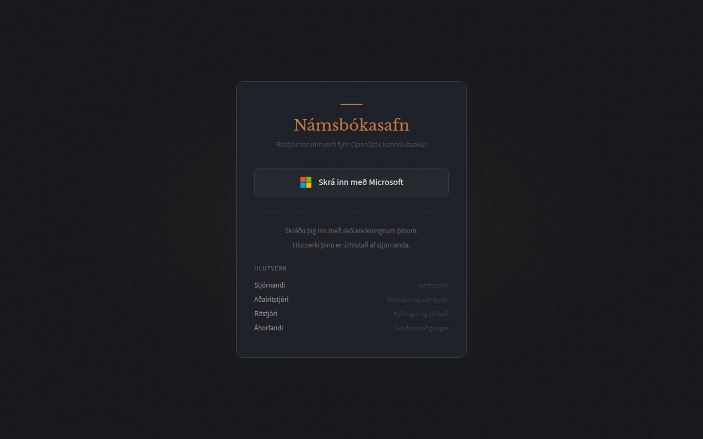
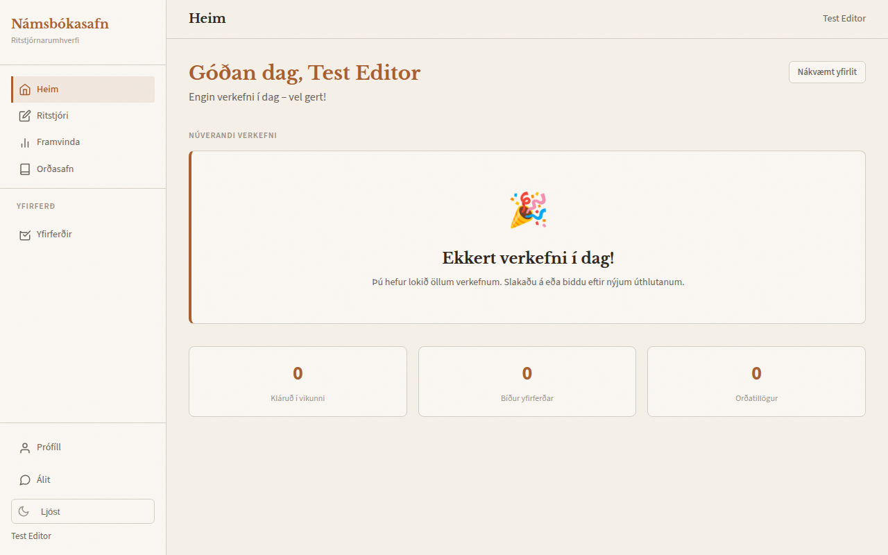
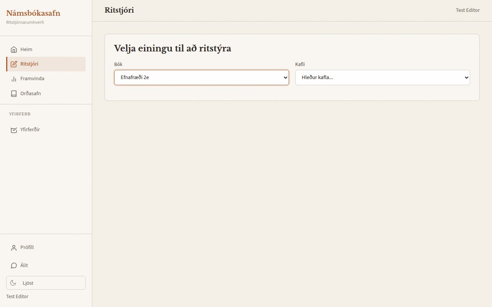
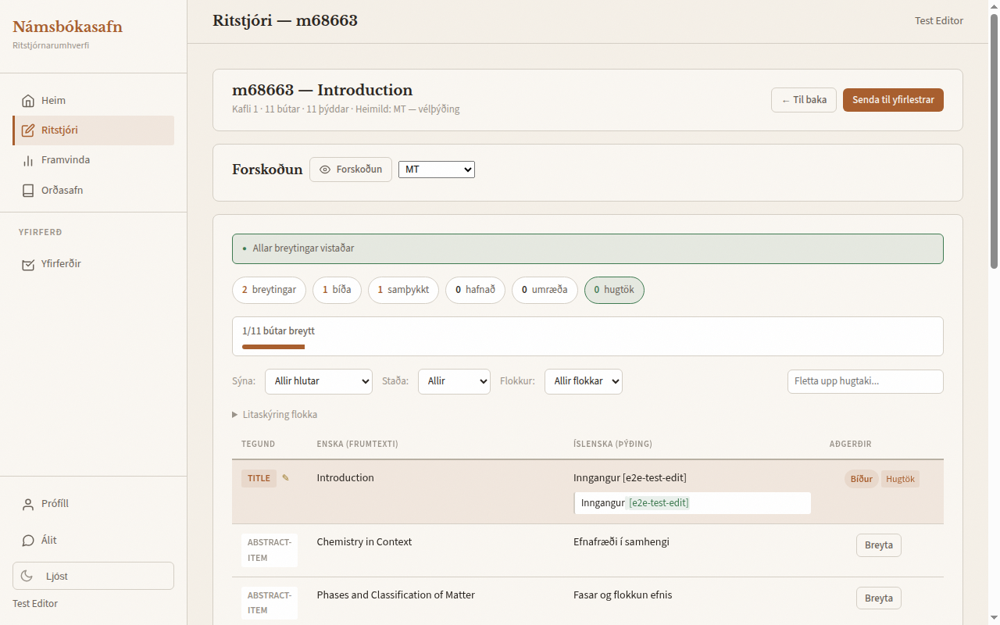
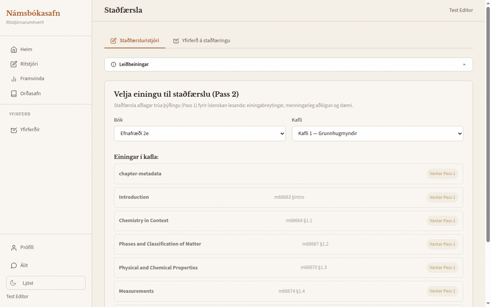
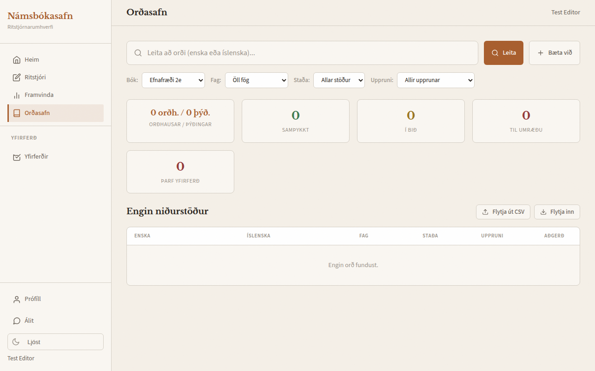
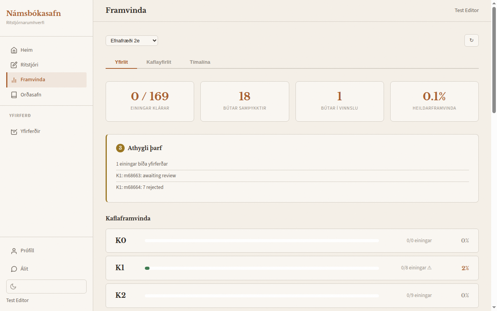
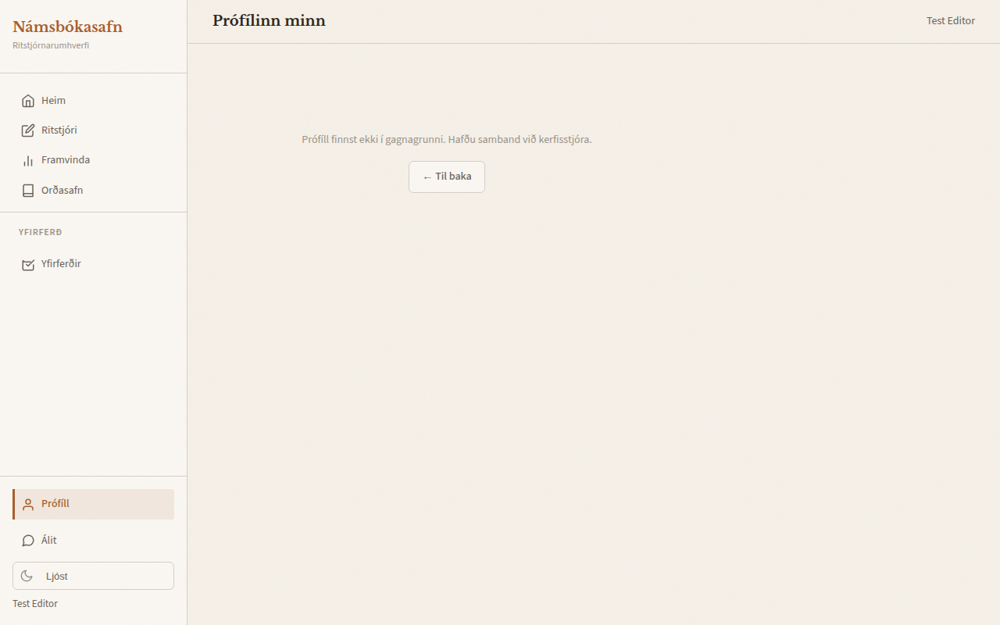
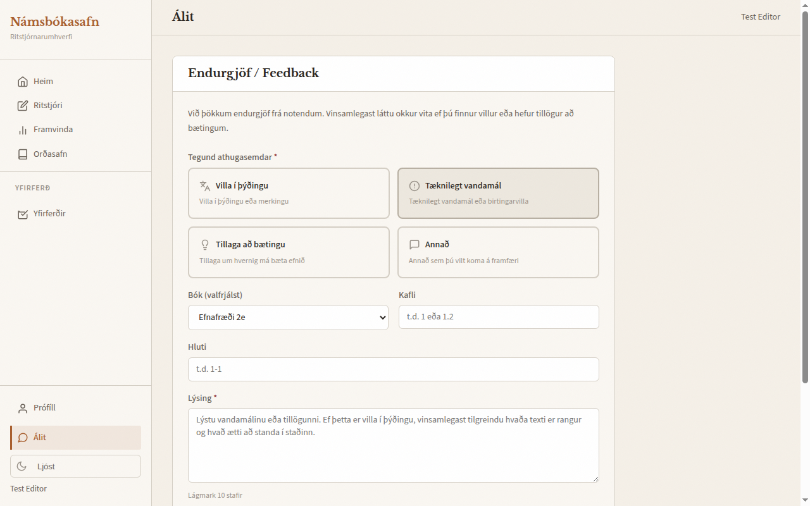

# Editor Guide — Námsbókasafn

Welcome to the Námsbókasafn translation team! This visual guide walks you through everything you need to know to start reviewing and editing translations of OpenStax textbooks into Icelandic.

> **Also see:** [Pass 1: Linguistic Review](../editorial/pass1-linguistic.md) and [Pass 2: Localization](../editorial/pass2-localization.md) for detailed editorial guidelines.

> **About the screenshots:** they were taken in March 2026, and several labels have changed
> since (for example, the editor is now **Ritill**). Where a screenshot and the text disagree,
> the text describes the current server.

---

## 1. Getting Started

### What is Námsbókasafn?

Námsbókasafn ("Textbook Library") is an editorial platform for translating open-source OpenStax textbooks into Icelandic. The workflow has two review passes:

| Pass | Name | Purpose |
|------|------|---------|
| **Pass 1** | Linguistic Review | Fix grammar, accuracy, and terminology in the machine translation |
| **Pass 2** | Localization | Adapt for Icelandic students: convert units, replace cultural references, add local context |

The translation pipeline flows like this:

```
Machine Translation → Pass 1 (Faithful Translation) → Pass 2 (Localized Version)
```

### Your Role as an Editor

As an editor, you can:
- Review and edit translated text segments (Pass 1)
- Look up and propose terminology
- Track your progress across chapters

Localization (Pass 2) is opened from the sidebar by head editors and admins.

### Logging In

1. Go to the editorial portal (your admin will give you the URL)
2. You will see the login page:



3. Click **"Skrá inn með Microsoft"** (Sign in with Microsoft)
4. Sign in with your school Microsoft account
5. After successful login, you land on the home page (**Heim**) — or, if you were sent to the login page from another page, back on that page

> **Note:** Your role is assigned by an administrator. If your profile page (**Um mig**) says
> **Þú ert gestur** (you are a guest), the system has no account for you yet: you can look
> around but not change anything. Contact your admin.

---

## 2. The Interface

### Dashboard

After logging in, you land on the home page (**Heim**). It greets you by name and tells you how many tasks you have.



The dashboard displays:
- **Núverandi verkefni** (current task), with a button to start working, and **Næst á dagskrá** (what's next)
- **Statistics**: editors see work finished this week (*Kláruð í vikunni*), work awaiting review (*Bíður yfirlestrar*) and their term proposals (*Orðatillögur*); head editors and admins see what awaits their decision and what is approved but not yet published
- **Nákvæmt yfirlit** (detailed view): your submissions awaiting review, edits sent back to you with the reviewer's note (*Breytingar óskast*), your term proposals, and your recent activity
- **Stillingar** (Settings): choose which kinds of notification you get, in the app and by email (email is sent only when the server is set up for it)

### Navigation Sidebar

The sidebar on the left is your main navigation. The sections visible depend on your role:

**Everyone who is signed in sees:**
- **Heim** (Home) — Your dashboard
- **Ritill** (Editor) — The segment editor for Pass 1
- **Framvinda** (Progress) — Translation progress overview
- **Orðasafn** (Terminology) — The term database

**Editors, head editors and admins also see a Yfirlestur (Review) section:**
- **Yfirlestrar** (Reviews) — The segment editor, filtered to edits awaiting review
- **Aðlögun** (Localization) — The localization editor for Pass 2 (head editors and admins only)

**Head editors and admins also see a Stjórnun (Administration) section:**
- **Bókasafn** (Library) and **Úthlutanir** (Assignments); admins also see **Stjórnandi** (Admin panel)

**At the bottom:**
- **Um mig** (About me) — Your profile
- **Ábendingar** (Feedback) — Submit feedback about translations
- **Theme toggle** — Switch between light and dark mode

---

## 3. Pass 1: Segment Editor (Linguistic Review)

The segment editor (**Ritill**) is where you will spend most of your time. It displays individual text segments (paragraphs, headings, list items) so you can review the machine translation and correct errors.

> **Goal:** Create a *faithful translation* — natural, accurate Icelandic that closely represents the source text. Do NOT localize (that happens in Pass 2).

### Selecting a Module

1. Navigate to **Ritill** in the sidebar
2. Select a **book** (*Bók*, e.g. "Efnafræði 2e" for Chemistry)
3. Select a **chapter** (*Kafli*)
4. You will see the modules in the chapter (*Einingar í kafla*) — click one to start editing



Each module card shows status badges, such as:
- **EN** — English source segments exist
- **MT** — Machine translation is available
- **Ritstýrt** / **Staðfært** — The module has been edited / localized
- **⚠ N** — The automatic machine-translation check flagged N segments

### Editing Segments

After clicking a module, the editor loads all segments in a table:



- **Enska (frumtexti):** English source text (read-only)
- **Íslenska (þýðing):** Icelandic translation
- **Aðgerðir:** Actions for the segment

Above the table, filters narrow the list by what to show (*Sýna*), by status (*Staða*: unchanged, unreviewed, edited, approved, confirmed, rejected, in discussion) and by category (*Flokkur*).

**To edit a segment:**

1. Click **Breyta** (Edit) in the segment's row
2. Make your correction
3. Select a **category** for your edit (*Flokkur*):
   - **Hugtök** (terminology) — Term replacement or standardization
   - **Nákvæmni** (accuracy) — Factual correction or mistranslation fix
   - **Læsileiki** (readability) — Grammar, spelling, or clarity improvement
   - **Stíll** (style) — Tone or style adjustment
   - **Úrfelling** (omission) — Missing content added back
4. Optionally add an **editor note** (*Athugasemd (valkvætt)*) explaining your change
5. Click **Vista** (Save), or press Ctrl+S

> **Saving:** your edit reaches the server only when you save it. Until then the browser keeps a
> local draft every few seconds, so a closed tab can be recovered, but nobody else sees it.

**If the machine translation is already right**, click **✓ Staðfesta MT** (Confirm MT) instead of editing. It marks the segment as checked; you can undo it.

**Other help in the editor:**
- **Term lookup** (*Fletta upp hugtaki…*) — look up a term without leaving the page; terms in the text are highlighted and open a popup with their translations
- **Samhengisleit** (context search) — search earlier approved translations
- **Þegar samþykkt í …** — the same text was already approved elsewhere; **Nota þessa þýðingu** reuses it
- **Beita víðar** — apply your translation to identical segments in the book
- **Forskoðun** (Preview) — see how the module will look to readers

### What to Fix (and What to Leave)

| Do | Do Not |
|----|--------|
| Fix grammar and spelling | Convert units (miles, Fahrenheit, etc.) |
| Improve word choice for clarity | Change cultural references |
| Ensure natural Icelandic | Add Icelandic examples |
| Check terminology consistency | Remove or add content |
| Verify technical accuracy | Localize anything |

### Submitting for Review

When you have reviewed all segments in a module:

1. Click **"Senda til yfirlestrar"** (Submit for Review)
2. Your edits go to the Head Editor for approval
3. You can follow your submissions on the home page: **Nákvæmt yfirlit → Bíður yfirlestrar**

The Head Editor then marks each edit:
- **Samþykkja** (Approve)
- **Hafna** (Reject), with a reason
- **Ræða** (Discuss), with a topic for discussion

A note from the Head Editor reaches you on the home page under **Breytingar óskast**, with a
**Laga** (Fix) button. When an edit is marked **Ræða**, its row in the editor shows a
**💬 Umræða** (Discussion) button: it opens the Head Editor's topic and the replies so far, and
you can answer there with **Senda svar** (Send reply). Replying does not change the edit's
status — the Head Editor still decides. An edit that has a discussion cannot be deleted; revise
it instead.

---

## 4. Pass 2: Localization Editor

After Pass 1 produces a faithful translation, Pass 2 adapts it for Icelandic students. This is a separate editor designed for cultural adaptation, opened from **Aðlögun** in the sidebar (head editors and admins). A module can be localized only once it has an approved faithful translation.

### Opening the Localization Editor

1. Navigate to **Aðlögun** in the sidebar
2. Select a book and chapter
3. Click a module to start



The localization editor has two tabs at the top:
- **Staðfærsluritill** — The editor view, with a collapsible **Leiðbeiningar** (Guidelines) panel
- **Yfirlestur á staðfæringu** — Pattern-based localization suggestions for a section (*Skanna*), which can be accepted or rejected, and the localization log

When a book requires localization review, head editors also see a panel of pending localization edits (*Staðfærsla í bið*) to approve or reject.

### Three-Column Layout

When a module is loaded, the editor shows three columns:
- **Enska (viðmið):** English source (reference)
- **Trú þýðing (Pass 1):** Faithful Icelandic translation (read-only, with an **Afrita** (Copy) button)
- **Staðfært (Pass 2):** Localized version (editable)

### Types of Localization

Localized changes are grouped into these types, which the editor's filter and badges use:

| Type | Example |
|------|---------|
| **Einingabreytingar** (unit conversion) | Fahrenheit → Celsius, miles → km |
| **Menningarleg aðlögun** (cultural adaptation) | American holidays → Icelandic equivalents |
| **Dæmaskipti** (example replacement) | US-specific examples → local context |
| **Snið** (formatting) | Style adjustments for Icelandic conventions |

### Saving Work

- Save a segment with its **✓** button (tooltip *Vista bút*)
- Use **"Vista allt"** (Save All) to save all changes at once
- The editor also saves your work automatically every minute
- **Breytingasaga** (change history) shows a segment's earlier versions and can restore one

---

## 5. Terminology

### The Terminology Database

Visit **Orðasafn** (Terminology) in the sidebar to browse, search, and manage translation terms.



The terminology page provides:
- **Search bar** — Search by English or Icelandic term
- **Filters** — Filter by book, subject (*Fag*), status (*Staða*) and origin (*Uppruni*)
- **Statistics** — Headwords and translations, approved, pending, under discussion, and needs-review counts
- **Term table** — English term, Icelandic translation, subject, status and origin
- **Yfirferðarröð** (review queue) — Terms waiting for review

### Searching for Terms

1. Type the English or Icelandic term in the search bar
2. Optionally filter by book, subject, status or origin
3. Click **"Leita"** (Search)

### Proposing New Terms

If you encounter a term not in the glossary:

1. Click **"Bæta við"** (Add)
2. Enter the English term and your proposed Icelandic translation
3. Add notes explaining your choice
4. Save — the term is stored as a proposal until a Head Editor or admin approves it

You can also comment on an existing term, and suggest an alternative translation, from the term's detail view.

### Terminology in the Segment Editor

When editing segments in Pass 1, use the term lookup box (*Fletta upp hugtaki…*) to search the term database without leaving the page. Clicking a highlighted term in the text opens a popup listing its translations, their status and subjects, with a link to open the term in **Orðasafn**.

---

## 6. Tracking Progress

The **Framvinda** (Progress) page gives you an overview of translation progress across all chapters.



The page shows:
- **Summary statistics** — Modules finished, segments approved, segments in progress, and overall progress
- **Þarfnast skoðunar** (Needs attention) — Modules awaiting review, edits in discussion, and chapters with rejected or pending edits
- **Chapter list** — Each chapter with a progress bar showing how far along the editing is

Click a chapter to open its overview (*Kaflayfirlit*), with the status of each module. A third tab, **Tímalína**, shows a timeline.

---

## 7. Other Pages

### Profile

Visit **Um mig** to see and update your account information: name, email (read-only), school, subject, a short description, your role, and when you last signed in.



### Feedback

The **Ábendingar** (Feedback) page is a public form — no login needed — for reporting problems with or suggesting improvements to published content.



You can submit feedback about:
- An error in a translation or its meaning
- A technical or display problem
- An improvement to the content
- Anything else

---

## 8. Tips and Troubleshooting

### "I don't know how to translate this term"

1. Check the terminology database at **Orðasafn**
2. If not found, propose a new term
3. Add an editor note on the segment explaining your uncertainty

### "The machine translation is very wrong"

That is expected! Your job is to fix it. Do not hesitate to rewrite entire sentences if needed. Categorize the edit as **Nákvæmni** (accuracy) or **Læsileiki** (readability).

### "The machine translation is already right"

Click **✓ Staðfesta MT** so the segment counts as checked.

### "I found a structural or formatting error"

- If it is in the translation text, fix it and categorize as **Læsileiki** (readability)
- If it is a rendering problem (broken layout, missing images), report it to the admin

### "I disagree with a previous terminology decision"

- Follow the existing decision for consistency
- Raise the issue with the Head Editor, or comment on the term in **Orðasafn**
- Do not change established terminology without approval

### Getting Help

1. **Translation questions** — Add an editor note on the segment
2. **Terminology questions** — Propose or comment on a term at **Orðasafn**
3. **Technical problems** — Contact the admin
4. **General questions** — Ask at the team meeting

---

## Quick Reference

| Task | Where to Go |
|------|-------------|
| Edit translations (Pass 1) | **Ritill** (Editor) |
| See edits awaiting review | **Yfirlestrar** (Reviews) |
| Localize content (Pass 2) | **Aðlögun** (Localization) — head editors and admins |
| Look up / propose terms | **Orðasafn** (Terminology) |
| Check progress | **Framvinda** (Progress) |
| Submit feedback | **Ábendingar** (Feedback) |
| View your profile | **Um mig** (About me) |

---

*Welcome to the team! Don't hesitate to ask questions — we're all learning together.*
